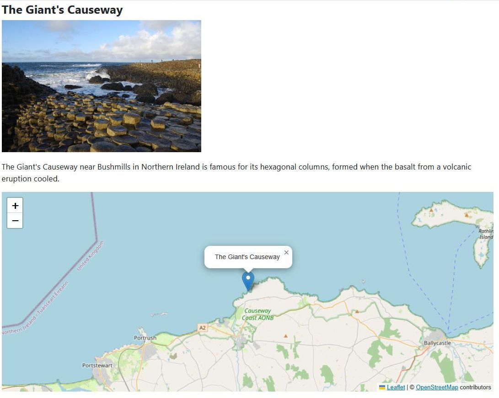

## Introduction

In this step we add a field to hold the location (latitude/longitude aka lat/long) of the landmark,
and using JavaScript we display this location on a map.



The code is available at [com_example step 15](https://github.com/joomla/manual-examples/tree/main/component-tutorial/step15_map).

As described in the [Maps Module](../../modules/module-examples/map-module.md#background)
you can use a variety of solutions for the map tiles and the JavaScript library code.
In this step we use [leaflet](https://leafletjs.com/), which is a popular open source JavaScript library for drawing maps,
and use the map tiles from [OpenStreetMap](https://www.openstreetmap.org/).

## Learning Points

Including JavaScript code

Web Asset Manager and joomla.asset.json

Passing data to the JavaScript code

Passing language constants to the JavaScript code

Front-end language constants

Field Groups

## Approach

We define a database column to hold the location, which will contain the location lat and long as a JSON-encoded field.

On the back-end we'll add a field to the landmark edit form to enable an administrator to define the location.

We'll also add the location to the admin landmarks view.

On the front-end we'll add a map which shows the location of the landmark. 
If the location hasn't been defined then we output a "Location not defined" message,
which is implemented as a language string on the front-end, and passed to the JavaScript to be output.

## Database Changes

By now you'll be familiar with what needs to be done!

```sql title="com_example/administrator/components/com_example/sql/install.mysql.sql"
CREATE TABLE IF NOT EXISTS `#__example_landmarks` (
    `id`        INT(11)     NOT NULL AUTO_INCREMENT,
    `title`     VARCHAR(40) NOT NULL,
    `description` TEXT      NOT NULL,
    `published` TINYINT(4)  NOT NULL DEFAULT 1,
    `picture`   TEXT        NOT NULL,
  /* highlight-next-line */
    `location`  TEXT        NOT NULL,
    PRIMARY KEY (`id`)
);

/* highlight-start */
INSERT INTO `#__example_landmarks` (`title`, `description`, `published`, `picture`, `location`) VALUES
('The Eiffel Tower', '', 1, '', '{"lat":"48.858222","long":"2.2945"}'),
('The Giant\'s Causeway', '', 1, '', '{"lat":"55.240833","long":"-6.511667"}');
/* highlight-end */
```

The new SQL update file:

```sql title="com_example/administrator/components/com_example/sql/updates/mysql/0.15.0.sql"
ALTER TABLE `#__example_landmarks` 
ADD COLUMN `location` TEXT NOT NULL;
UPDATE `#__example_landmarks` 
SET `location` = '{"lat":"48.858222","long":"2.2945"}'
WHERE `title` = 'The Eiffel Tower';
UPDATE `#__example_landmarks` 
SET `location` = '{"lat":"55.240833","long":"-6.511667"}'
WHERE `title` = 'The Giant\'s Causeway';
```

## Back-end Changes

### Administrator Edit Form

Here's the updated XML definition of the edit form:

```xml title="administrator/components/com_example/forms/landmark.xml"
<?xml version="1.0" encoding="utf-8"?>
<form> 
    <field
            name="title"
            type="text"
            label="COM_EXAMPLE_LANDMARK_TITLE_LABEL"
            description="COM_EXAMPLE_LANDMARK_TITLE_DESC"
            required="true"
            default=""
            />
    <field  name="description" 
            type="editor"
            label="COM_EXAMPLE_LANDMARK_DESCRIPTION_LABEL" 
            description="COM_EXAMPLE_LANDMARK_DESCRIPTION_DESC"
            filter="\Joomla\CMS\Component\ComponentHelper::filterText" 
            buttons="true" 
            />
    <field
            name="published"
            type="list"
            label="JSTATUS"
            default="1"
            validate="options"
            >
            <option value="1">JPUBLISHED</option>
            <option value="0">JUNPUBLISHED</option>
            <option value="-2">JTRASHED</option>
    </field>
    <fieldset name="details">
        <field
                name="picture"
                label="COM_EXAMPLE_LANDMARK_PICTURE_LABEL"
                description="COM_EXAMPLE_LANDMARK_PICTURE_DESC"
                type="accessiblemedia"
                />
    <!-- highlight-start -->
        <fields name="location">
            <field
                name="lat"
                label="COM_EXAMPLE_LANDMARK_LATITUDE_LABEL"
                description="COM_EXAMPLE_LANDMARK_LATITUDE_DESC"
                type="number"
                />
            <field
                name="long"
                label="COM_EXAMPLE_LANDMARK_LONGITUDE_LABEL"
                description="COM_EXAMPLE_LANDMARK_LONGITUDE_DESC"
                type="number"
                />
        </fields>
    <!-- highlight-end -->
        <field
                name="id"
                type="text"
                label="JGLOBAL_FIELD_ID_LABEL"
                class="readonly"
                default="0"
                readonly="true"
                />    
    </fieldset>
</form>
```

As you can see we've added two `<field>` elements of type="number",
and enclosed them within a field group `<fields>`.

:::warning
  The "number" type field is implemented by an HTML `<input type="number">`, and this is implemented differently on different browsers. 
  Also there is no validation on the size of the number
  (the Joomla NumberField "max" and "min" attributes just control the little up/down arrows of the input field) 
  but we'll address this when we look at validation. 
:::

As described in [Field Groups](../../../general-concepts/forms/manipulating-forms.md#field-groups)
the effect of the `<fields>` tag is that the data sent to the server in the HTTP POST is of the form:

```
jform[location][lat]
jform[location][long]
```

This is like the accessiblemedia field from the previous tutorial step, 
and to get the data written to the database we just have to adopt the same solution as before:

```php title="administrator/components/com_example/src/Table/LandmarkTable.php"
<?php
namespace My\Component\Example\Administrator\Table;
 
\defined('_JEXEC') or die;

use Joomla\CMS\Table\Table;
use Joomla\Database\DatabaseInterface;

class LandmarkTable extends Table
{
  // highlight-next-line
    protected $_jsonEncode = ['picture', 'location'];
    
    public function __construct(DatabaseInterface $db)
    {
        parent::__construct('#__example_landmarks', 'id', $db);
    }
}
```

Note again that Joomla handles these POST updates seamlessly
because we set the `name` attribute of the `<fields>` element to be the same as the name of the database column, namely 'location'.

We don't need to do anything extra to get the new fields rendered on the edit form,
because the `<fields>` element is within the `<fieldset name="details">` element, 
so it will get rendered when the fieldset is output in the tmpl file:

```php
<?php echo $this->form->renderFieldset('details');  ?>
```

However, we need a small change to the LandmarkModel related to prefilling the form data with data from the database.
For the location data we need to perform a json_decode within the loadFormData function to get it into the right format for display:

```php title="administrator/components/com_example/src/Model/LandmarkModel.php::loadFormData"
    protected function loadFormData()  // the callback function which is called if $loadData was true
    {
        // Check the session for previously entered form data.
        $data = Factory::getApplication()->getUserState('com_example.edit.landmark.data', array());

        if (empty($data))
        {
            $data = $this->getItem();
      // highlight-next-line
            $data->location = $data->location ? json_decode($data->location) : null;  
        }

        return $data;
    }
```

### Administrator Landmarks Form

To get the location displayed on the administrator landmarks form we need to do the following:

- we create a new column in the HTML `<table>` for the location. 
This will mean a new header (which we'll make a sortable header), and data output in the rows in the form `[lat, long]`

- to make the location header sortable, we add the 'location' field into the config as a permitted field for sorting

- we also need to change the filter fields XML definition to allow sorting by the location column

- we change the database query to include the location information

Here's the updated tmpl file:

```php title="administrator/components/com_example/tmpl/landmarks/default.php
<?php

\defined('_JEXEC') or die;

use Joomla\CMS\HTML\HTMLHelper;
use Joomla\CMS\Language\Text;
use Joomla\CMS\Router\Route;
use Joomla\CMS\Button\PublishedButton;
use Joomla\CMS\Layout\LayoutHelper;

$listOrder = $this->escape($this->state->get('list.ordering'));
$listDirn  = $this->escape($this->state->get('list.direction'));
?>
<form action="<?php echo Route::_('index.php?option=com_example&view=landmarks'); ?>" method="post" name="adminForm" id="adminForm">

    <?php echo LayoutHelper::render('joomla.searchtools.default', ['view' => $this]); ?>

    <table class="table">
        <caption class="visually-hidden">
            <?php echo Text::_('COM_EXAMPLE_LANDMARKS_CAPTION'); ?>
        </caption>
        <thead>
            <tr>
                <td class="w-1 text-center">
                    <?php echo HTMLHelper::_('grid.checkall'); ?>
                </td>
                <th scope="col">
                    <?php echo HTMLHelper::_('searchtools.sort', 'COM_EXAMPLE_LANDMARK_TITLE_LABEL', 'title', $listDirn, $listOrder); ?>
                </th>
    <!-- highlight-start -->
                <th scope="col" class="w-10 text-center">
                    <?php echo HTMLHelper::_('searchtools.sort', 'COM_EXAMPLE_LANDMARKS_LOCATION', 'location', $listDirn, $listOrder); ?>
                </th>
    <!-- highlight-end -->
                <th scope="col" class="w-1 text-center">
                    <?php echo Text::_('JSTATUS'); ?>
                </th>
                <th scope="col">
                    <?php echo HTMLHelper::_('searchtools.sort', 'JGRID_HEADING_ID', 'id', $listDirn, $listOrder); ?>
                </th>
            </tr>
        </thead>
        <tbody><?php foreach ($this->items as $i => $item) :?>
                    <tr>
                        <td class="text-center">
                            <?php echo HTMLHelper::_('grid.id', $i, $item->id, false, 'cid', 'cb', $item->title); ?>
                        </td>
                        <th scope="row">
                            <?php 
                                $url = Route::_('index.php?option=com_example&task=landmark.edit&id=' . $item->id);
                                $linkText = $this->escape($item->title); 
                                echo "<a href='{$url}'>{$linkText}</a>";
                            ?>
                        </th>
    <!-- highlight-start -->
                        <td class="text-center">
                            <?php
                                if ($item->location) 
                                {
                                    $location = json_decode($item->location);
                                    $lat = floatval($location->lat);
                                    $long = floatval($location->long);
                                    echo "[{$lat}, {$long}]";
                                }
                                else
                                {
                                    echo "";
                                }
                            ?>
                        </td>
    <!-- highlight-end -->
                        <td class="text-center">
                            <?php
                                $options = [
                                    'task_prefix' => 'landmarks.',
                                    'id' => 'published-' . $item->id,
                                ];
                                echo (new PublishedButton())->render((int) $item->published, $i, $options);
                            ?>
                        </td>
                        <td>
                            <?php echo (int) $item->id; ?>
                        </td>
                    </tr>
                <?php endforeach; ?>
        </tbody>
    </table>
    
    <?php echo $this->pagination->getListFooter(); ?>
    
    <input type="hidden" name="task" value="" />
    <input type="hidden" name="boxchecked" value="0" />
    <?php echo HTMLHelper::_('form.token'); ?>
</form>
```

Here's the updated Model file:

```php title="administrator/components/com_example/src/Model/LandmarksModel.php"
<?php

namespace My\Component\Example\Administrator\Model;

\defined('_JEXEC') or die;

use Joomla\CMS\MVC\Model\ListModel;
use Joomla\CMS\MVC\Factory\MVCFactoryInterface;
use Joomla\Database\ParameterType;

class LandmarksModel extends ListModel
{
    public function __construct($config = [], ?MVCFactoryInterface $factory = null)
    {
        if (empty($config['filter_fields'])) {
            $config['filter_fields'] = [
                'id',
                'title',
                'published',
          // highlight-next-line
                'location',
            ];
        }
        parent::__construct($config, $factory);
    }
    
    protected function getListQuery()
    {
        $db = $this->getDatabase();
        $query = $db->getQuery(true);

      // highlight-next-line
        $query->select('id, title, published, location')
            ->from($db->quoteName('#__example_landmarks'));

        // Filtering - by search string
        $search = $this->getState('filter.search');
        if (!empty($search)) {
            $search = '%' . str_replace(' ', '%', trim($search)) . '%';
            $query->where($db->quoteName('title') . ' LIKE :search')
                  ->bind(':search', $search);
        }
        
        // Filtering - by published state
        $published = (string) $this->getState('filter.published');
        if ($published !== '*') {  // if All is selected, then we don't add a WHERE clause, otherwise ...
            if (is_numeric($published)) {  // if a single publish state is selected, then add WHERE clause for that state
                $state = (int) $published;
                $query->where($db->quoteName('published') . ' = :state')
                    ->bind(':state', $state, ParameterType::INTEGER);
            } else {  // if no particular state is selected, then add WHERE clause to include Published and Unpublished states
                $query->whereIn($db->quoteName('published'), [0,1]);
            }
        }

        // Ordering
        $orderCol  = $this->state->get('list.ordering', 'id');
        $orderDirn = $this->state->get('list.direction', 'ASC');
        $query->order($db->escape($orderCol) . ' ' . $db->escape($orderDirn));

        return $query;
    }
    
    protected function populateState($ordering = 'id', $direction = 'asc')
    {
        parent::populateState($ordering, $direction);
    }
}
```

Here's the updated "fullordering" field within the filter fields XML definition:

```xml title="administrator/components/com_example/forms/filter_landmarks.xml"
...
        <field
            name="fullordering"
            type="list"
            label="JGLOBAL_SORT_BY"
            class="js-select-submit-on-change"
            default="id ASC"
            validate="options"
            >
            <option value="">JGLOBAL_SORT_BY</option>
            <option value="title ASC">COM_EXAMPLE_LANDMARK_TITLE_ASCENDING</option>
            <option value="title DESC">COM_EXAMPLE_LANDMARK_TITLE_DESCENDING</option>
    <!-- highlight-start -->
            <option value="location ASC">COM_EXAMPLE_LANDMARK_LOCATION_ASCENDING</option>
            <option value="location DESC">COM_EXAMPLE_LANDMARK_LOCATION_DESCENDING</option>
    <!-- highlight-end -->
            <option value="id ASC">JGRID_HEADING_ID_ASC</option>
            <option value="id DESC">JGRID_HEADING_ID_DESC</option>
        </field>
...
```

### Administrator Language Strings

```php title="administrator/components/com_example/language/en-GB/com_example.ini"
COM_EXAMPLE_LANDMARK_FIELD_SELECT_TITLE="Landmark"
COM_EXAMPLE_LANDMARK_FIELD_SELECT_DESC="Select a landmark"
; Admin landmarks view
COM_EXAMPLE_LANDMARKS_VIEW_TITLE="Landmarks"
COM_EXAMPLE_LANDMARKS_CAPTION="Table of Landmarks"
COM_EXAMPLE_LANDMARK_TITLE_LABEL="Name"
// highlight-next-line
COM_EXAMPLE_LANDMARKS_LOCATION="Location"
; Admin landmarks view - filter fields
COM_EXAMPLE_LANDMARK_TITLE_ASCENDING="Name ascending"
COM_EXAMPLE_LANDMARK_TITLE_DESCENDING="Name descending"
// highlight-start
COM_EXAMPLE_LANDMARK_LOCATION_ASCENDING="Location ascending"
COM_EXAMPLE_LANDMARK_LOCATION_DESCENDING="Location descending"
// highlight-end
; Admin landmarks view - confirmations
COM_EXAMPLE_N_ITEMS_DELETED_1="Landmark deleted."
COM_EXAMPLE_N_ITEMS_DELETED="%d Landmarks deleted."
COM_EXAMPLE_N_ITEMS_PUBLISHED_1="Landmark published."
COM_EXAMPLE_N_ITEMS_PUBLISHED="%d Landmarks published."
COM_EXAMPLE_N_ITEMS_UNPUBLISHED_1="Landmark unpublished."
COM_EXAMPLE_N_ITEMS_UNPUBLISHED="%d Landmarks unpublished."
COM_EXAMPLE_N_ITEMS_TRASHED_1="Landmark moved to trash."
COM_EXAMPLE_N_ITEMS_TRASHED="%d Landmarks moved to trash."
; Admin landmark edit form
COM_EXAMPLE_LANDMARK_EDIT="Landmarks: Edit"
COM_EXAMPLE_LANDMARK_TITLE_DESC="Name of the landmark"
COM_EXAMPLE_LANDMARK_DESCRIPTION_LABEL="Description"
COM_EXAMPLE_LANDMARK_DESCRIPTION_DESC="A summary description of the landmark"
COM_EXAMPLE_LANDMARK_PICTURE_LABEL="Landmark image"
COM_EXAMPLE_LANDMARK_PICTURE_DESC="A picture of the landmark"
// highlight-start
COM_EXAMPLE_LANDMARK_LATITUDE_LABEL="Latitude"
COM_EXAMPLE_LANDMARK_LATITUDE_DESC="Latitude between -90.0 and 90.0"
COM_EXAMPLE_LANDMARK_LONGITUDE_LABEL="Longitude"
COM_EXAMPLE_LANDMARK_LONGITUDE_DESC="Longitude between -180.0 and 180.0"
// highlight-end
COM_EXAMPLE_SAVE_SUCCESS="Landmark successfully saved"
; Admin landmark edit form - tabs
COM_EXAMPLE_LANDMARK_GENERAL_TAB="General"
COM_EXAMPLE_LANDMARK_DETAILS_TAB="Details"
```

## Front-end Changes

### tmpl file

The Controller, View and Model classes are all unaffected, and the changes are concentrated in the tmpl file:

```php title="components/com_example/tmpl/landmark/default.php
<?php
\defined('_JEXEC') or die;
use Joomla\CMS\HTML\HTMLHelper;
// highlight-start
use Joomla\CMS\Language\Text;

$this->document->getWebAssetManager()->usePreset("com_example.map");

// Prepare the location data for sending to the JavaScript code
if ($this->data->location) {
    $location = json_decode($this->data->location);
    $lat = $location->lat;
    $long = $location->long;
    $locationDefined = true;
} else {
    $lat = '0';
    $long = '0';
    $locationDefined = false;
}

// Pass the language constant and location data down to JS
Text::script('COM_EXAMPLE_LANDMARK_LOCATION_NOT_DEFINED');
$mapParams = ['landmark' => $this->data->title, 'latitude' => $lat, 'longitude' => $long, 'locationDefined' => $locationDefined];
$this->document->addScriptOptions('com_example.mapParams', $mapParams);
// highlight-end
?>
<h4><?php echo $this->escape($this->data->title);?></h4>
<?php 
    $picture = json_decode($this->data->picture);
    if ($picture) {
        $src = $picture->imagefile ?? "";
        if (strlen($src) > 0) {
            $clean = HTMLHelper::_('cleanImageURL', $src);
            $altText = $picture->alt_text ? $this->escape($picture->alt_text) : "";
            echo "url}\" alt='{$altText}'>";
        }
    }
?>
<p><?php echo $this->data->description;?></p>
// highlight-next-line
<div id="map"></div>
```

The JavaScript and CSS resources which we want to use are included using:

```php
$this->document->getWebAssetManager()->usePreset("com_example.map");
```

This will be explained in more detail below.

To pass the language constant (and its associated value) to JavaScript you use:

```php
Text::script('COM_EXAMPLE_LANDMARK_LOCATION_NOT_DEFINED');
```

See [Passing Language Constants to JavaScript](../../../general-concepts/javascript/adding-javascript.md#passing-language-constants-to-javascript).

To pass the location data to JavaScript you use:

```php
$this->document->addScriptOptions('com_example.mapParams', $mapParams);
```

See [Passing Variables to JavaScript](../../../general-concepts/javascript/adding-javascript.md#passing-variables-to-javascript).
Note that we've included the extension name 'com_example' within the key 
to avoid clashing with data being passed by other extensions. 

We've also included a `<div>` which is where the map will be loaded (or where the "location not defined" message will be inserted).

### JavaScript and CSS Code

Within our js code we retrieve the values passed from our PHP code 
and follow the [leaflet example](https://leafletjs.com/) to create a basic map.

```php title="com_example/media/com_example/js/map.js"
import {LeafletMap, TileLayer, Marker} from "https://cdn.jsdelivr.net/npm/leaflet@2.0.0-alpha.1/dist/leaflet.js";

const params = Joomla.getOptions('com_example.mapParams');
if (params.locationDefined) {
    const latitude = parseFloat(params.latitude);
    const longitude = parseFloat(params.longitude);

    const map = new LeafletMap('map').setView([latitude, longitude], 11);

    new TileLayer('https://tile.openstreetmap.org/{z}/{x}/{y}.png', {
        attribution: '&copy; <a href="https://www.openstreetmap.org/copyright">OpenStreetMap</a> contributors'
    }).addTo(map);

    new Marker([latitude, longitude]).addTo(map)
        .bindPopup(params.landmark)
        .openPopup();
} else {
    document.getElementById("map").innerText = Joomla.Text._("COM_EXAMPLE_LANDMARK_LOCATION_NOT_DEFINED");
}
```

Note the functions which are used to retrieve the data and language constant sent from the server.

We also create a basic CSS file:

```php title="com_example/media/com_example/css/map.css"
#map {
  height: 400px;
}
```

JavaScript and CSS files for components should all be located under the media/ folder of the Joomla instance,
and we will need a new section in the install manifest XML file to load them into the target directory.

### Web Asset Manager

The display of our map is obviously dependent upon the leaflet js and css files,
so we need to ensure that they are loaded before we start importing variables from them,
as well as ensuring that we're using the correct versions of the leaflet resources. 

Also our map.js code uses the Joomla.getOptions and Joomla.Text._ functions, both of which are found in the Joomla system core.js library.
So we will need that library js code as well.

Joomla has a Web Asset Manager which removes the pain of handling all these dependencies,
and you may find it useful to read the early sections of the [Web Asset Manager documentation](../../../general-concepts/web-asset-manager.md).

The com_example joomla.asset.json file is where we list the css and js assets we're using, together with their versions and dependencies.
When a visitor navigates to a site page of com_example, then Joomla reads our component joomla.asset.json file to register its assets. 

Our code needs to "use" the specific assets which it requires from the list of assets in the joomla.asset.json file,
by calling [useStyle](cms-api://classes/Joomla-CMS-WebAsset-WebAssetManager.html#method_useStyle) or [useScript](cms-api://classes/Joomla-CMS-WebAsset-WebAssetManager.html#method_useScript) for the relevant asset. 
The Web Asset Manager will then ensure that these assets are loaded by the browser,
together with any dependencies (and so on, down the dependency chain). 

In our code we use a [preset](../../../general-concepts/web-asset-manager.md#working-with-a-presets),
which is just a shorthand way of using several assets grouped together. 
Calling usePreset is the same as calling useStyle or useScript on each of its dependencies. 

```json title="media/com_example/joomla.asset.json"
{
  "$schema": "https://developer.joomla.org/schemas/json-schema/web_assets.json",
  "name": "com_example",
  "version": "1.0.0",
  "description": "Joomla CMS",
  "license": "GPL-2.0-or-later",
  "assets": [
    {
      "name": "com_example.map",
      "type": "preset",
      "dependencies": [
        "com_example.map#style",
        "com_example.map#script"
      ],
      "version": "1.0.0"
    },
    {
      "name": "com_example.map",
      "type": "style",
      "uri": "com_example/map.css",
      "dependencies": [
        "com_example.leaflet"
      ],
      "attributes": {},
      "version": "1.0.0"
    },
    {
      "name": "com_example.map",
      "type": "script",
      "uri": "com_example/map.js",
      "dependencies": [
        "com_example.leaflet",
        "core"
      ],
      "attributes": {
        "type": "module"
      },
      "version": "1.0.0"
    },
    {
      "name": "com_example.leaflet",
      "type": "script",
      "uri": "https://cdn.jsdelivr.net/npm/leaflet@2.0.0-alpha.1/dist/leaflet.js",
      "dependencies": [],
      "attributes": {
        "type": "module"
      },
      "version": "2.0.0-alpha.1"
    },
    {
      "name": "com_example.leaflet",
      "type": "style",
      "uri": "https://cdn.jsdelivr.net/npm/leaflet@2.0.0-alpha.1/dist/leaflet.css",
      "dependencies": [],
      "attributes": {},
      "version": "2.0.0-alpha.1"
    }
  ]
}
```

So there are 5 assets in the joomla.asset.json file:

- our map.js and map.css code files

- the leaflet js and css code files

- the preset which groups together our map js and css code assets

For each of the script and style assets we tell Joomla where to find the source:

- for external libraries we provide the URL

- for our com_example code files we specify the path below the media/ folder,
but with the js and css segments of the path removed. Joomla inserts this segment of the path, so that:

  - uri "com_example/map.js" for a script maps to media/com_example/js/map.js

  - uri "com_example/map.css" for a style maps to media/com_example/css/map.css

The "attributes" of js assets are generally mapped to the attributes of the HTML `<script>` element,
and as leaflet uses js modules we need to include the attribute "type": "module" for both our map.js (which performs imports)
and the leaflet.js code (which performs exports).

### Language String

We need a new file to hold our first language constant used on the front-end:

```php title="components/com_example/language/en-GB/com_example.ini"
COM_EXAMPLE_LANDMARK_LOCATION_NOT_DEFINED="Landmark location not defined"
```

## Manifest File

As well as updating the version number we need to include the media and front-end language sections.

```xml title="example.xml"
<?xml version="1.0" encoding="UTF-8"?>
<extension type="component" method="upgrade">

    <name>COM_EXAMPLE_TITLE</name>
    <creationDate>today</creationDate>
    <author>me</author>
    <license>GPL v3</license>
  <!-- highlight-next-line -->
    <version>0.15.0</version>
    <description>COM_EXAMPLE_DESCRIPTION</description>

    <element>com_example</element>

    <namespace path="src">My\Component\Example</namespace>

    <files folder="components/com_example">
        <folder>src</folder>
        <folder>tmpl</folder>
    </files>
    
  <!-- highlight-start -->
    <languages folder="components/com_example/language">
        <language tag="en-GB">en-GB/com_example.ini</language>
    </languages>
  <!-- highlight-end -->

    <administration>
        <files folder="administrator/components/com_example">
            <folder>forms</folder>
            <folder>services</folder>
            <folder>sql</folder>
            <folder>src</folder>
            <folder>tmpl</folder>
        </files>
        <languages folder="administrator/components/com_example/language">
            <language tag="en-GB">en-GB/com_example.ini</language>
            <language tag="en-GB">en-GB/com_example.sys.ini</language>
        </languages>
        <menu link="option=com_example">COM_EXAMPLE_MENU</menu>
        <submenu>
            <menu link="option=com_example&amp;view=landmarks">COM_EXAMPLE_MENU</menu>
        </submenu>
    </administration>

    <install>
        <sql>
            <file driver="mysql" charset="utf8">sql/install.mysql.sql</file>
        </sql>
    </install>

    <uninstall>
        <sql>
            <file driver="mysql" charset="utf8">sql/uninstall.mysql.sql</file>
        </sql>
    </uninstall>
    
    <update>
        <schemas>
            <schemapath type="mysql">sql/updates/mysql</schemapath>
        </schemas>
    </update>
    
  <!-- highlight-start -->
    <media destination="com_example" folder="media/com_example">
        <filename>joomla.asset.json</filename>
        <folder>css</folder>
        <folder>js</folder>
    </media>
  <!-- highlight-end -->

</extension>
```

## Exploring your installation

Once you have install the updated version you can use your browser's devtools to view:

- the form of the location parameters sent in the HTTP POST when the landmark edit form is submitted

- the form of the `<script>` and CSS `<link>` elements in the HTML head.
Note that the URLs of our js and css files have got the asset version number included as a parameter (ie after the question mark).
This means that when you modify your code and update the version number then the URL overall will be changed.
This forces the browser to request the new file rather than using a cached copy. 

- the `<script>` element of type application/json which includes the language constant and PHP variables passed

## Challenge

### importmap

This requires you to be running a version of Joomla at least 5.0,
(and the [documentation for importmap](../../../general-concepts/web-asset-manager.md#working-with-esm-importmap) in this manual is only in version 5.0 and above).

The [Leaflet Quick Start Guide](https://leafletjs.com/examples/quick-start/) suggests using an importmap.

Can you change the "com_example.leaflet" script asset in joomla.asset.json so that

- importmap is true

- importmapName is "leaflet"

If you get it right then you should be able to do in map.js:

```php title="com_example/media/com_example/js/map.js"
import {LeafletMap, TileLayer, Marker} from "leaflet";
```

(If you're changing the map.js code but not the version, 
then be sure to force the browser to load the new version rather than using a cached copy,
eg on a PC by pressing the Shift key as you click the reload button).

You may find it helpful to view the [Joomla PR for importmap](https://github.com/joomla/joomla-cms/pull/40714).

### integrity

The [leaflet documentation](https://leafletjs.com/examples/quick-start/) also proposes using an "integrity" attribute 
to ensure that the library code which your extension is relying upon has not been tampered with.

Can you change the "attributes" of the "com_example.leaflet" script asset 
so that "integrity" has the value "sha256-gj5JhNAaMi6LCs+jVFOk8sXDe1sWSS2Zlc87m+trLiQ="?

To prove that it's working, change the hash value slightly and confirm that the browser refuses to run the code.