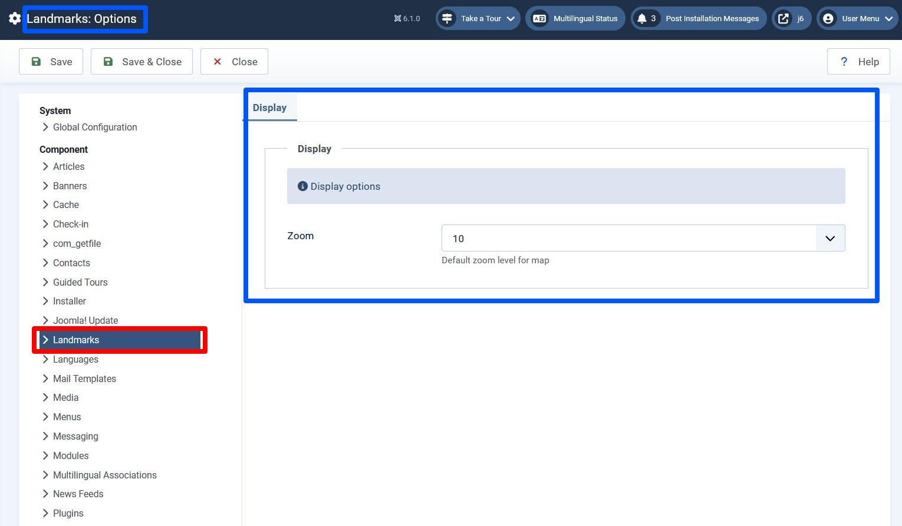

## Introduction

When we displayed the map in the previous step we hard-coded a zoom level of 11. 
In this step we make this zoom level configurable.

The code is available at [com_example step 16](https://github.com/joomla/manual-examples/tree/main/component-tutorial/step16_config).

Joomla configuration operates at 2 levels:

- Configuration at the component level - accessed via System / Global Configuration on the administrator back-end.
This is managed by com_config, and allows you to define configuration parameters for your extension.
The data is held as a JSON-encoded string of the configuration key/value pairs, 
and is stored in the database in the `params` column of the extension's record in the `#__extensions` table.

- Configuration at an individual record level - component configuration values can be overridden for individual records, 
in our case, for individual landmark records. This is managed wholly within the extension code. 
Joomla components manage this by storing these configuration overrides as a JSON-encoded string 
in a column of the component's own database table, and we'll follow that paradigm. 

The work we have to do within the administrator back-end to manage these configuration overrides
is really the same as what we had to do to implement the 'location' data - 
we're just defining fields whose values get stored as JSON-encoded strings in a database column.
However, as we shall see, for the configuration data it's important that the component configuration parameter
and the individual record override have the same 'name' attribute. 

In this step we set up 

- a default map zoom value which is set in component configuration

- a landmark-level zoom value which can override the component configuration value.

## Learning Points

Implementing Configuration parameters

Install script

Database quoting and prepared statements

## Component Config

Here's what we will do to implement component configuration for com_example:

1. Write a config.xml file which contains the default zoom field

2. Add the necessary language constants

3. Display a button on the landmarks view to provide a short cut to accessing our component config

4. Using an install script, set the default zoom value to 10

### Config.xml File

This is the file which com_config reads to determine what fields to display for each component.
The filename and the path name are important, to enable com_config to find it.

```xml title="administrator/components/com_example/config.xml"
<?xml version="1.0" encoding="utf-8"?>
<config>
    <fieldset
        name="display"
        label="COM_EXAMPLE_CONFIG_DISPLAY_SETTINGS_LABEL"
        description="COM_EXAMPLE_CONFIG_DISPLAY_SETTINGS_DESC"
        >
        <field
            name="zoom"
            type="integer"
            label="COM_EXAMPLE_CONFIG_DEFAULT_ZOOM_LABEL"
            description="COM_EXAMPLE_CONFIG_DEFAULT_ZOOM_DESC"
            first="0"
            last="20"
            step="1"
        />
    </fieldset>
</config>
```

Outermost `<fieldset>` elements map to the tabs of the component's configuration parameters.
Any inner `<fieldset>` elements map to regions within each tab where related parameters can be grouped together.
The `name` attribute of the `<fieldset>` element doesn't matter.

### Language Strings



The language constant in the red rectangle has to be defined in the .sys.ini file, 
because text from multiple components is shown on this page. 
The areas in blue contain language constants in the .ini file, as they're shown only when Landmarks configuration is selected.

```php title="administrator/components/com_example/language/en-GB/com_example.sys,ini"
COM_EXAMPLE_TITLE="Joomla Component Tutorial"
COM_EXAMPLE_DESCRIPTION="Builds an example application for managing famous landmarks"
; Menu items
COM_EXAMPLE_LANDMARK_MENUITEM_TITLE="Landmark"
COM_EXAMPLE_LANDMARK_MENUITEM_DESCRIPTION="Displays a famous landmark"
; Admin menu
COM_EXAMPLE_MENU="Landmarks"
// highlight-start
; Component Config
COM_EXAMPLE="Landmarks"
// highlight-end
```

```php title="administrator/components/com_example/language/en-GB/com_example.ini"
COM_EXAMPLE_LANDMARK_FIELD_SELECT_TITLE="Landmark"
COM_EXAMPLE_LANDMARK_FIELD_SELECT_DESC="Select a landmark"
; Admin landmarks view
COM_EXAMPLE_LANDMARKS_VIEW_TITLE="Landmarks"
COM_EXAMPLE_LANDMARKS_CAPTION="Table of Landmarks"
COM_EXAMPLE_LANDMARK_TITLE_LABEL="Name"
COM_EXAMPLE_LANDMARKS_LOCATION="Location"
; Admin landmarks view - filter fields
COM_EXAMPLE_LANDMARK_TITLE_ASCENDING="Name ascending"
COM_EXAMPLE_LANDMARK_TITLE_DESCENDING="Name descending"
COM_EXAMPLE_LANDMARK_LOCATION_ASCENDING="Location ascending"
COM_EXAMPLE_LANDMARK_LOCATION_DESCENDING="Location descending"
; Admin landmarks view - confirmations
COM_EXAMPLE_N_ITEMS_DELETED_1="Landmark deleted."
COM_EXAMPLE_N_ITEMS_DELETED="%d Landmarks deleted."
COM_EXAMPLE_N_ITEMS_PUBLISHED_1="Landmark published."
COM_EXAMPLE_N_ITEMS_PUBLISHED="%d Landmarks published."
COM_EXAMPLE_N_ITEMS_UNPUBLISHED_1="Landmark unpublished."
COM_EXAMPLE_N_ITEMS_UNPUBLISHED="%d Landmarks unpublished."
COM_EXAMPLE_N_ITEMS_TRASHED_1="Landmark moved to trash."
COM_EXAMPLE_N_ITEMS_TRASHED="%d Landmarks moved to trash."
; Admin landmark edit form
COM_EXAMPLE_LANDMARK_EDIT="Landmarks: Edit"
COM_EXAMPLE_LANDMARK_TITLE_DESC="Name of the landmark"
COM_EXAMPLE_LANDMARK_DESCRIPTION_LABEL="Description"
COM_EXAMPLE_LANDMARK_DESCRIPTION_DESC="A summary description of the landmark"
COM_EXAMPLE_LANDMARK_PICTURE_LABEL="Landmark image"
COM_EXAMPLE_LANDMARK_PICTURE_DESC="A picture of the landmark"
COM_EXAMPLE_LANDMARK_LATITUDE_LABEL="Latitude"
COM_EXAMPLE_LANDMARK_LATITUDE_DESC="Latitude between -90.0 and 90.0"
COM_EXAMPLE_LANDMARK_LONGITUDE_LABEL="Longitude"
COM_EXAMPLE_LANDMARK_LONGITUDE_DESC="Longitude between -180.0 and 180.0"
// highlight-start
COM_EXAMPLE_LANDMARK_ZOOM_LABEL="Zoom level"
COM_EXAMPLE_LANDMARK_ZOOM_DESC="Zoom level for the map, between 0 and 20"
// highlight-end
COM_EXAMPLE_SAVE_SUCCESS="Landmark successfully saved"
; Admin landmark edit form - tabs
COM_EXAMPLE_LANDMARK_GENERAL_TAB="General"
COM_EXAMPLE_LANDMARK_DETAILS_TAB="Details"
// highlight-start
; Component Configuration
COM_EXAMPLE_CONFIGURATION="Landmarks: Options"
COM_EXAMPLE_CONFIG_DISPLAY_SETTINGS_LABEL="Display"
COM_EXAMPLE_CONFIG_DISPLAY_SETTINGS_DESC="Display options"
COM_EXAMPLE_CONFIG_DEFAULT_ZOOM_LABEL="Zoom"
COM_EXAMPLE_CONFIG_DEFAULT_ZOOM_DESC="Default zoom level for map"
// highlight-end
```

The file includes the 2 new language constants (COM_EXAMPLE_LANDMARK_ZOOM_LABEL and COM_EXAMPLE_LANDMARK_ZOOM_DESC)
for the zoom override as well, which will be set in our admin edit form.

### Preferences Button

We add a button on the Landmarks view which will give an administrator a short cut to the configuration parameters.

```php title="administrator/components/com_example/src/View/Landmarks/HtmlView.php::addToolBar"
    private function addToolBar() 
    {
        ToolBarHelper::title(Text::_('COM_EXAMPLE_LANDMARKS_VIEW_TITLE'), 'camera');
        ToolbarHelper::addNew('landmark.add', 'JTOOLBAR_NEW');   // New button
        $toolbar  = $this->getDocument()->getToolbar();
        $dropdown = $toolbar->dropdownButton('status-group')
            ->text('JTOOLBAR_CHANGE_STATUS')
            ->toggleSplit(false)
            ->icon('icon-ellipsis-h')
            ->buttonClass('btn btn-action')
            ->listCheck(true);
        $childBar = $dropdown->getChildToolbar();
        $childBar->publish('landmarks.publish')->listCheck(true);
        $childBar->unpublish('landmarks.unpublish')->listCheck(true);

        if ($this->state->get('filter.published') != -2) {  // add a "move to trash" button to child toolbar
            $childBar->trash('landmarks.trash')->listCheck(true);
        }
        if ($this->state->get('filter.published') == -2) {  // add an "empty trash" button to main toolbar
            $toolbar->delete('landmarks.delete', 'JTOOLBAR_DELETE_FROM_TRASH')
                ->message('JGLOBAL_CONFIRM_DELETE')
                ->icon('fa fa-circle-xmark')
                ->listCheck(true);
        }
    // highlight-next-line
        $toolbar->preferences('com_example');
    }
```

### Install Script

We need to update the `params` column of the com_example record in the `#__extensions` table to contain the default zoom value,
which we'll set at 10.
We could do this by a SQL update statement in a SQL update file, 
but this becomes more complicated if we add another configuration parameter in a future version,
because we'd need to take account of where an administrator had changed our default zoom parameter to a value other than 10.

So instead we implement the database logic in an install script.
You should be familiar with these if you've done the [module tutorial](../../modules/module-development-tutorial/step6-script-file.md).
As described in the [install script documentation](../../install-update/installation/install-process.md#example-script-file),
there are two forms of the script file, and in this step we use the second:

Unlike the SQL update files, which run only on a single install and then never again,
the install script is run every time the component is installed,
so we have to take care not to change any existing configuration which an administrator may have set. 

```php title="com_example/script.php"
<?php
use Joomla\CMS\Application\AdministratorApplication;
use Joomla\CMS\Installer\InstallerAdapter;
use Joomla\CMS\Installer\InstallerScriptInterface;
use Joomla\CMS\Language\Text;
use Joomla\Database\DatabaseInterface;
use Joomla\DI\Container;
use Joomla\DI\ServiceProviderInterface;

\defined('_JEXEC') or die;

return new class () implements ServiceProviderInterface {
  public function register(Container $container)
  {
    $container->set(
      InstallerScriptInterface::class,
      new class (
      $container->get(AdministratorApplication::class),
      $container->get(DatabaseInterface::class)
      ) implements InstallerScriptInterface {
        private AdministratorApplication $app;
        private DatabaseInterface $db;

        public function __construct(AdministratorApplication $app, DatabaseInterface $db)
        {
          $this->app = $app;
          $this->db  = $db;
        }

        public function install(InstallerAdapter $parent): bool
        {
          $this->app->enqueueMessage('Successfully installed.');

          return true;
        }

        public function update(InstallerAdapter $parent): bool
        {
          $this->app->enqueueMessage('Successfully updated.');

          return true;
        }

        public function uninstall(InstallerAdapter $parent): bool
        {
          $this->app->enqueueMessage('Successfully uninstalled.');

          return true;
        }

        public function preflight(string $type, InstallerAdapter $parent): bool
        {
          return true;
        }

        public function postflight(string $type, InstallerAdapter $parent): bool
        {
          $this->setDefaultConfig($this->db);
          return true;
        }

        private function setDefaultConfig(DatabaseInterface $db)
        {
          // Get the existing params from the com_example record in the #__extensions table
          $element = "com_example";
          $query = $db->createQuery();
          $query->select($db->quoteName('params'))
                ->from($db->quoteName('#__extensions'))
                ->where($db->quoteName('element') . ' = :element')
                ->bind(':element', $element);
          $db->setQuery($query);
          $params = $db->loadResult();
          $currentParams = json_decode($params);
          
          // Set up the params to be written to the db, carrying forward any existing values
          $newParams = new \stdClass();
          $newParams->zoom = $currentParams->zoom ?? 10;
          if ($newParams != $currentParams) {
            $params = json_encode($newParams);
            $query = $db->createQuery()
              ->update($db->quoteName('#__extensions'))
              ->set($db->quoteName('params') . ' = :params')
              ->where($db->quoteName('element') . ' = :element')
              ->bind(':params', $params)
              ->bind(':element', $element);
            $db->setQuery($query);
            $result = $db->execute();
            if ($result) {
              $this->app->enqueueMessage('Configuration parameters updated.');
            } else {
              throw new \Exception("Unable to update config params");
            }
          }
        }
      }
    );
  }
};
```

The script file above shows the correct way to write SQL select and update statements,
as described in the [Database documentation](../../../general-concepts/database/index.md):

- use $db->quoteName around column names - this basically adds quotes (like backticks) around the names,
so that they don't clash (either now or in the future) with reserved keywords of the database language

- use prepared statements, and then bind the variables later. 
In the update case above, the SQL query is compiled after the update, set and where calls,
and then the variables are inserted using the bind calls before the query is executed. 
Since the values of the variables are often provided from the Internet, 
this approach provides immunity against SQL injection attacks. 

### Accessing Component Configuration values

In the install script above we accessed the component configuration parameters using a database query.
However, you can get the values more easily using:

```php
$params = \Joomla\CMS\Component\ComponentHelper::getParams('com_example');
```

The function [getParams](cms-api://classes/Joomla-CMS-Component-ComponentHelper.html#method_getParams) 
returns a [Registry](../../../general-concepts/registry.md) object. 

Alternatively you can get the parameters using:

```php
use Joomla\CMS\Factory;
...
$app = Factory::getApplication();
$params = $app->getParams();
```

However, with this latter method you will get additional parameters set -
see libraries/src/Application/SiteApplication.php::getParams().
If you use this second approach then you need to ensure that your component parameters do not match any of these additional parameters.

## Config Overrides

To implement an override of the zoom level at the individual landmark record level we do the following:

- add a 'params' field to the `#__example_landmarks` table and populate initially with an empty JSON string

- provide administrator functionality to manage the zoom level within the params

The implementation is very similar to what was done to implement the 'location' field in [step 15](./step15-map.md).

### Database Changes

```sql title="com_example/administrator/components/com_example/sql/install.mysql.sql"
CREATE TABLE IF NOT EXISTS `#__example_landmarks` (
    `id`        INT(11)     NOT NULL AUTO_INCREMENT,
    `title`     VARCHAR(40) NOT NULL,
    `description` TEXT      NOT NULL,
    `published` TINYINT(4)  NOT NULL DEFAULT 1,
    `picture`   TEXT        NOT NULL,
    `location`  TEXT        NOT NULL,
  /* highlight-next-line */
    `params`    TEXT        NOT NULL,
    PRIMARY KEY (`id`)
);

  /* highlight-start */
INSERT INTO `#__example_landmarks` (`title`, `description`, `published`, `picture`, `location`, `params`) VALUES
('The Eiffel Tower', '', 1, '', '{"lat":"48.858222","long":"2.2945"}', '{}'),
('The Giant\'s Causeway', '', 1, '', '{"lat":"55.240833","long":"-6.511667"}', '{}');
  /* highlight-end */
```

The new SQL update file:

```sql title="com_example/administrator/components/com_example/sql/updates/mysql/0.16.0.sql"
ALTER TABLE `#__example_landmarks` 
ADD COLUMN `params` TEXT NOT NULL;
UPDATE `#__example_landmarks` 
SET `params` = '{}';
```

### Administrator Edit Form

The changes we need to make to implement the zoom level override in the admin edit form are:

- include the zoom level as a field within the XML definition of the admin edit form.
We include it within an existing fieldset which is already output in the tmpl file.

- include the `params` field within the list of arrays to be JSON-encoded before writing to the database

The 2 additional language constants (for the zoom field) were included above.

```xml title="administrator/components/com_example/forms/landmark.xml"
<?xml version="1.0" encoding="utf-8"?>
<form> 
    <field
            name="title"
            type="text"
            label="COM_EXAMPLE_LANDMARK_TITLE_LABEL"
            description="COM_EXAMPLE_LANDMARK_TITLE_DESC"
            required="true"
            default=""
            />
    <field  name="description" 
            type="editor"
            label="COM_EXAMPLE_LANDMARK_DESCRIPTION_LABEL" 
            description="COM_EXAMPLE_LANDMARK_DESCRIPTION_DESC"
            filter="\Joomla\CMS\Component\ComponentHelper::filterText" 
            buttons="true" 
            />
    <field
            name="published"
            type="list"
            label="JSTATUS"
            default="1"
            validate="options"
            >
            <option value="1">JPUBLISHED</option>
            <option value="0">JUNPUBLISHED</option>
            <option value="-2">JTRASHED</option>
    </field>
    <fieldset name="details">
        <field
                name="picture"
                label="COM_EXAMPLE_LANDMARK_PICTURE_LABEL"
                description="COM_EXAMPLE_LANDMARK_PICTURE_DESC"
                type="accessiblemedia"
                />
        <fields name="location">
            <field
                name="lat"
                label="COM_EXAMPLE_LANDMARK_LATITUDE_LABEL"
                description="COM_EXAMPLE_LANDMARK_LATITUDE_DESC"
                type="number"
                />
            <field
                name="long"
                label="COM_EXAMPLE_LANDMARK_LONGITUDE_LABEL"
                description="COM_EXAMPLE_LANDMARK_LONGITUDE_DESC"
                type="number"
                />
        </fields>
  <!-- highlight-start -->
        <fields name="params">
            <field 
                name="zoom"
                label="COM_EXAMPLE_LANDMARK_ZOOM_LABEL"
                description="COM_EXAMPLE_LANDMARK_ZOOM_DESC"
                type="integer"
                first="0"
                last="20"
                step="1"
                useglobal="true"
                />
        </fields>
  <!-- highlight-end -->
        <field
                name="id"
                type="text"
                label="JGLOBAL_FIELD_ID_LABEL"
                class="readonly"
                default="0"
                readonly="true"
                />    
    </fieldset>
</form>
```

```php title="administrator/components/com_example/src/Table/LandmarkTable.php"
<?php
namespace My\Component\Example\Administrator\Table;
 
\defined('_JEXEC') or die;

use Joomla\CMS\Table\Table;
use Joomla\Database\DatabaseInterface;

class LandmarkTable extends Table
{
  // highlight-next-line
    protected $_jsonEncode = ['picture', 'location', 'params'];
    
    public function __construct(DatabaseInterface $db)
    {
        parent::__construct('#__example_landmarks', 'id', $db);
    }
}
```

## Front-end Changes

In the front-end we need to get the configured zoom level, taking into account any override for this landmark,
and then pass the zoom level down to the JavaScript.

We sort out the zoom level to use in the LandmarkModel,
and we use a general approach which will work for any other parameters we define in the future.

```php title="components/com_example/src/Model/LandmarkModel.php"
<?php
namespace My\Component\Example\Site\Model;
 
\defined('_JEXEC') or die;

use Joomla\CMS\MVC\Model\ItemModel;
use Joomla\CMS\Factory;
// highlight-start
use Joomla\CMS\Component\ComponentHelper;
use Joomla\Registry\Registry;
// highlight-end

class LandmarkModel extends ItemModel
{
    function getItem($pk = null)
    {
        $app = Factory::getApplication();
        $input = $app->getInput();
        $id = $input->get('id', 0, 'INT');

        $table = $this->getTable('Landmark', 'Administrator');
        $result = $table->load($id);
        if ($result && $table->published == 1) {
          // highlight-start
            // convert the landmark record params to a Registry and merge with com_example component params
            $individualLandmarkParams = new Registry($table->params);
            $table->mergedParams = clone $this->getState('params');
            $table->mergedParams->merge($individualLandmarkParams);
          // highlight-end
            return $table;
        } else {
            throw new \UnexpectedValueException("id out of range");
        }
    }
    
  // highlight-start
    protected function populateState()
    {
        $params = ComponentHelper::getParams('com_example');
        $this->setState('params', $params);
    }
  // highlight-end
}
```

The Registry object has a [merge function](../../../general-concepts/registry.md#merging)
which overwrites its values with those of another Registry passed as a parameter. 
However, we don't want to pollute the original object, so we take a clone first.
Here it's important that the name of the zoom field in the component config 
is the same as in the individual landmark override,
so that the override value from the individual record overwrites the component config value.

In the tmpl file we use the merged parameters and pass the zoom down to the JS.

```php title="components/com_example/tmpl/landmark/default.php"
<?php
\defined('_JEXEC') or die;
use Joomla\CMS\HTML\HTMLHelper;
use Joomla\CMS\Language\Text;

// highlight-start
$zoom = $this->data->mergedParams->get('zoom');
$zoom = $zoom ?? 10;  // we shouldn't really need this!
// highlight-end

$this->document->getWebAssetManager()->usePreset("com_example.map");

// Prepare the location data for sending to the JavaScript code
if ($this->data->location) {
    $location = json_decode($this->data->location);
    $lat = $location->lat ?? "";
    $long = $location->long ?? "";
    $locationDefined = (strlen($lat) > 0) && (strlen($long) > 0);
} else {
    $lat = '0';
    $long = '0';
    $locationDefined = false;
}

// Pass the language constant and location data down to JS
Text::script('COM_EXAMPLE_LANDMARK_LOCATION_NOT_DEFINED');
// highlight-next-line
$mapParams = ['landmark' => $this->data->title, 'latitude' => $lat, 'longitude' => $long, 'locationDefined' => $locationDefined, 'zoom' => $zoom];
$this->document->addScriptOptions('com_example.mapParams', $mapParams);
?>
<h4><?php echo $this->escape($this->data->title);?></h4>
<?php 
    $picture = json_decode($this->data->picture);
    if ($picture) {
        $src = $picture->imagefile ?? "";
        if (strlen($src) > 0) {
            $clean = HTMLHelper::_('cleanImageURL', $src);
            $altText = $picture->alt_text ? $this->escape($picture->alt_text) : "";
            echo "url}\" alt='{$altText}'>";
        }
    }
?>
<p><?php echo $this->data->description;?></p>
<div id="map"></div>
```

And we need to use the passed zoom value in the JS code:

```js title="media/com_example/js/map.js"
import {LeafletMap, TileLayer, Marker} from "https://cdn.jsdelivr.net/npm/leaflet@2.0.0-alpha.1/dist/leaflet.js";

const params = Joomla.getOptions('com_example.mapParams');
if (params.locationDefined) {
    const latitude = parseFloat(params.latitude);
    const longitude = parseFloat(params.longitude);
// highlight-start
    const zoom = parseInt(params.zoom);

    const map = new LeafletMap('map').setView([latitude, longitude], zoom);
// highlight-end

    new TileLayer('https://tile.openstreetmap.org/{z}/{x}/{y}.png', {
        attribution: '&copy; <a href="https://www.openstreetmap.org/copyright">OpenStreetMap</a> contributors'
    }).addTo(map);

    new Marker([latitude, longitude]).addTo(map)
        .bindPopup(params.landmark)
        .openPopup();
} else {
    document.getElementById("map").innerText = Joomla.Text._("COM_EXAMPLE_LANDMARK_LOCATION_NOT_DEFINED");
}
```

As we're changing the map.js code we also need to change the version in the joomla.asset.json file;
this will ensure that the browser doesn't use a cached version of this file.

```json title="media/com_example/joomla.asset.json"
...
    {
      "name": "com_example.map",
      "type": "script",
      "uri": "com_example/map.js",
      "dependencies": [
        "com_example.leaflet",
        "core"
      ],
      "attributes": {
        "type": "module"
      },
   // highlight-next-line
      "version": "1.1.0"
    },
...
```

## Installation

In the manifest file, update the version number and include the config.xml file and script file:

```xml title="com_example/example.xml"
<?xml version="1.0" encoding="UTF-8"?>
<extension type="component" method="upgrade">

    <name>COM_EXAMPLE_TITLE</name>
    <creationDate>today</creationDate>
    <author>me</author>
    <license>GPL v3</license>
  <!-- highlight-next-line -->
    <version>0.16.0</version>
    <description>COM_EXAMPLE_DESCRIPTION</description>

    <element>com_example</element>

    <namespace path="src">My\Component\Example</namespace>

    <files folder="components/com_example">
        <folder>src</folder>
        <folder>tmpl</folder>
    </files>

    <languages folder="components/com_example/language">
        <language tag="en-GB">en-GB/com_example.ini</language>
    </languages>
    
    <administration>
        <files folder="administrator/components/com_example">
            <folder>forms</folder>
            <folder>services</folder>
            <folder>sql</folder>
            <folder>src</folder>
            <folder>tmpl</folder>
  <!-- highlight-next-line -->
            <filename>config.xml</filename>
        </files>
        <languages folder="administrator/components/com_example/language">
            <language tag="en-GB">en-GB/com_example.ini</language>
            <language tag="en-GB">en-GB/com_example.sys.ini</language>
        </languages>
        <menu link="option=com_example">COM_EXAMPLE_MENU</menu>
        <submenu>
            <menu link="option=com_example&amp;view=landmarks">COM_EXAMPLE_MENU</menu>
        </submenu>
    </administration>

    <install>
        <sql>
            <file driver="mysql" charset="utf8">sql/install.mysql.sql</file>
        </sql>
    </install>

    <uninstall>
        <sql>
            <file driver="mysql" charset="utf8">sql/uninstall.mysql.sql</file>
        </sql>
    </uninstall>
    
    <update>
        <schemas>
            <schemapath type="mysql">sql/updates/mysql</schemapath>
        </schemas>
    </update>

    <media destination="com_example" folder="media/com_example">
        <filename>joomla.asset.json</filename>
        <folder>css</folder>
        <folder>js</folder>
    </media>
    
  <!-- highlight-next-line -->
    <scriptfile>script.php</scriptfile>
    
</extension>
  <!-- highlight-next-line -->
```

and then install the updated component. 

## Exploring your installation

On the admin back-end navigate to System / Global Configuration,
and then select Landmarks to display the component configuration. 

You can experiment with changing the component config parameter, and overriding it for an individual landmark,
and comparing records in the database.


One of the lines in map.js is:

```js
new TileLayer('https://tile.openstreetmap.org/{z}/{x}/{y}.png', {
```

which means that this is the form of the URL used to get an individual tile. 
By switching on your browser's devtools and selecting the Network tab,
you should be able to see that the z component (for zoom) matches your configuration.

Also, navigate to the admin landmarks view, which displays the list of landmarks in the database,
and press the Options button, top right. 
This should take you to the configuration page for setting the default zoom level.
If you look in the URL you'll see a URL parameter which is something like:

return=aHR0cDovL2xvY2FsaG9zdC9qNi9hZG1pbmlzdHJhdG9yL2luZGV4LnBocD9vcHRpb249Y29tX2V4YW1wbGUmdmlldz1sYW5kbWFya3M%3D

The value is a base64-encoded URL, which is the URL of the landmarks view.
This is how Joomla knows to return to the landmarks view when you press Close on the config page.

You can find online a utility for decoding base64-encoded strings, and confirm your own `return` value.
