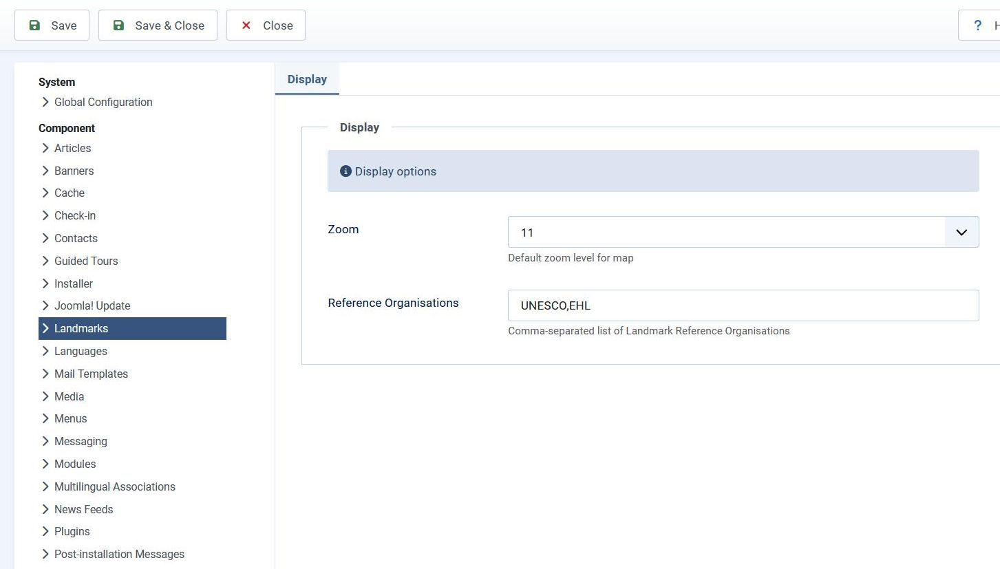
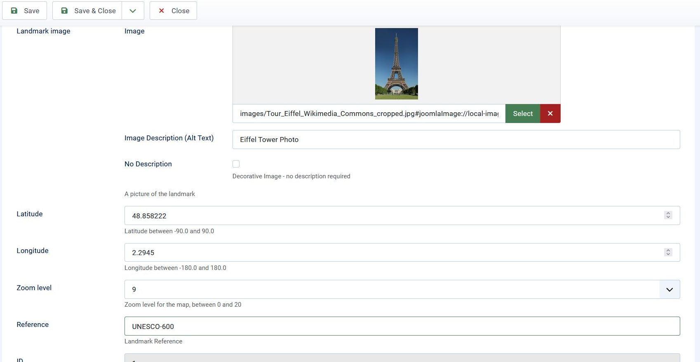
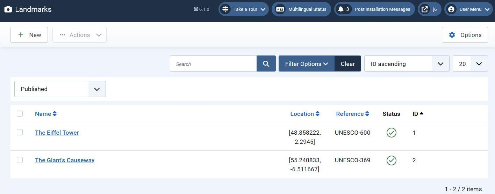
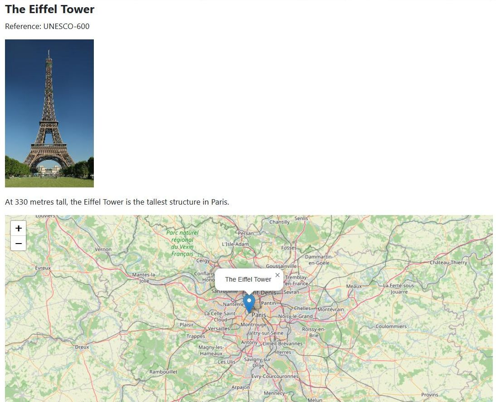

## Introduction

In this step we develop a custom server-side validation routine.

In this tutorial page there's only minimal code provided for this step,
and you're encouraged to develop the rest yourself, 
as it's repeating what has been covered in recent tutorial steps.

The code is available at [com_example step 18](https://github.com/joomla/manual-examples/tree/main/component-tutorial/step18_custom_validation).

## Learning Points

Server-side custom validation rules

Server-side custom validation messages

Language constants with embedded `%s`

## Functionality

Famous landmarks can be given a designation of a UNESCO world heritage site - eg [The Giant's Causeway](https://whc.unesco.org/en/list/369),
which has dossier number 369 - or can be [European Heritage Label sites](https://culture.ec.europa.eu/cultural-heritage/initiatives-and-success-stories/european-heritage-label/european-heritage-label-sites),
or registered through other organisations.

In this step we add a text column `reference` which can hold a reference such as UNESCO-369 or EHL-2019-10.

To validate the reference we add a component config parameter `referenceOrganisations`
which is a comma-separated list of organisations eg "UNESCO,EHL":



and we stipulate that the landmark reference text field must start with one of these organisations.
The reference field is added to the administrator landmark.xml file so that it appears on the edit form,
and we add custom server-side validation to force it to match the component configuration. 



The reference should be displayed on the landmarks form:



and on the site front-end:



## Approach

This is a step-wise guide which you should try and follow to implement the functionality above.

1. First of all, include the new admin language strings which are going to be needed:

```php title="administrator/components/com_example/language/en-GB/com_example.ini"
COM_EXAMPLE_LANDMARK_FIELD_SELECT_TITLE="Landmark"
COM_EXAMPLE_LANDMARK_FIELD_SELECT_DESC="Select a landmark"
; Admin landmarks view
COM_EXAMPLE_LANDMARKS_VIEW_TITLE="Landmarks"
COM_EXAMPLE_LANDMARKS_CAPTION="Table of Landmarks"
COM_EXAMPLE_LANDMARK_TITLE_LABEL="Name"
COM_EXAMPLE_LANDMARKS_LOCATION="Location"
// highlight-next-line
COM_EXAMPLE_LANDMARKS_REFERENCE="Reference"
; Admin landmarks view - filter fields
COM_EXAMPLE_LANDMARK_TITLE_ASCENDING="Name ascending"
COM_EXAMPLE_LANDMARK_TITLE_DESCENDING="Name descending"
COM_EXAMPLE_LANDMARK_LOCATION_ASCENDING="Location ascending"
COM_EXAMPLE_LANDMARK_LOCATION_DESCENDING="Location descending"
// highlight-start
COM_EXAMPLE_LANDMARK_REFERENCE_ASCENDING="Reference ascending"
COM_EXAMPLE_LANDMARK_REFERENCE_DESCENDING="Reference descending"
// highlight-end
; Admin landmarks view - confirmations
COM_EXAMPLE_N_ITEMS_DELETED_1="Landmark deleted."
COM_EXAMPLE_N_ITEMS_DELETED="%d Landmarks deleted."
COM_EXAMPLE_N_ITEMS_PUBLISHED_1="Landmark published."
COM_EXAMPLE_N_ITEMS_PUBLISHED="%d Landmarks published."
COM_EXAMPLE_N_ITEMS_UNPUBLISHED_1="Landmark unpublished."
COM_EXAMPLE_N_ITEMS_UNPUBLISHED="%d Landmarks unpublished."
COM_EXAMPLE_N_ITEMS_TRASHED_1="Landmark moved to trash."
COM_EXAMPLE_N_ITEMS_TRASHED="%d Landmarks moved to trash."
; Admin landmark edit form
COM_EXAMPLE_LANDMARK_EDIT="Landmarks: Edit"
COM_EXAMPLE_LANDMARK_TITLE_DESC="Name of the landmark"
COM_EXAMPLE_LANDMARK_DESCRIPTION_LABEL="Description"
COM_EXAMPLE_LANDMARK_DESCRIPTION_DESC="A summary description of the landmark"
COM_EXAMPLE_LANDMARK_PICTURE_LABEL="Landmark image"
COM_EXAMPLE_LANDMARK_PICTURE_DESC="A picture of the landmark"
COM_EXAMPLE_LANDMARK_LATITUDE_LABEL="Latitude"
COM_EXAMPLE_LANDMARK_LATITUDE_DESC="Latitude between -90.0 and 90.0"
COM_EXAMPLE_LANDMARK_LONGITUDE_LABEL="Longitude"
COM_EXAMPLE_LANDMARK_LONGITUDE_DESC="Longitude between -180.0 and 180.0"
COM_EXAMPLE_LANDMARK_ZOOM_LABEL="Zoom level"
COM_EXAMPLE_LANDMARK_ZOOM_DESC="Zoom level for the map, between 0 and 20"
// highlight-start
COM_EXAMPLE_LANDMARK_REFERENCE_LABEL="Reference"
COM_EXAMPLE_LANDMARK_REFERENCE_DESC="Landmark Reference"
// highlight-end
COM_EXAMPLE_SAVE_SUCCESS="Landmark successfully saved"
; Admin landmark edit form - tabs
COM_EXAMPLE_LANDMARK_GENERAL_TAB="General"
COM_EXAMPLE_LANDMARK_DETAILS_TAB="Details"
; Component Configuration
COM_EXAMPLE_CONFIGURATION="Landmarks: Options"
COM_EXAMPLE_CONFIG_DISPLAY_SETTINGS_LABEL="Display"
COM_EXAMPLE_CONFIG_DISPLAY_SETTINGS_DESC="Display options"
COM_EXAMPLE_CONFIG_DEFAULT_ZOOM_LABEL="Zoom"
COM_EXAMPLE_CONFIG_DEFAULT_ZOOM_DESC="Default zoom level for map"
COM_EXAMPLE_CONFIG_REF_ORGS_LABEL="Reference Organisations"
COM_EXAMPLE_CONFIG_REF_ORGS_DESC="Comma-separated list of Landmark Reference Organisations"
; Validation errors
COM_EXAMPLE_INVALID_TITLE="Name must be between 2 and 40 characters"
COM_EXAMPLE_INVALID_LATITUDE="Invalid latitude - please enter a value between -90.0 and 90.0"
COM_EXAMPLE_INVALID_LONGITUDE="Invalid longitude - please enter a value between -180.0 and 180.0"
// highlight-next-line
COM_EXAMPLE_INVALID_REFERENCE="Invalid reference - reference must begin with one of %s"
``` 

2. Add the new column `reference` to the database landmarks table - 
update the install.mysql.sql file and include a new updates/mysql/0.18.0.sql file.
You should allow the column to be null.
Install the component with these changes, then go into phpmyadmin and check that the column has been created ok.
If you make a mistake then you can recover by using phpmyadmin to:

  - restore the landmarks table to its previous state by deleting the new `reference` column
  
  - in the `#__extensions` table find the extension_id of the record which has element = 'com_example',
  then in the `#__schemas` table set the version_id for this extension_id back to '0.17.0'

3. Change the config.xml file to include the `referenceOrganisations` configuration parameter.
Use regex validation for this to exclude comma and white space within a reference organisation name,
and allowing a comma-separated list of organisations.

4. Update the script.php file setDefaultConfig() function to set `$newParams->referenceOrganisations` to 'UNESCO'
if the value has not been set. 
Install the new version and verify this is set correctly by inspecting the `params` column of the relevant record in the `#__extensions` table.
Check also that you can set the configuration parameter through the administrator Global Configuration / Landmarks page.

5. Add the reference field to the landmark.xml file to enable it to appear in the landmark edit form.
Add it after the `<fields>` element of the params, so that it appears after the zoom field.

```xml title="administrator/components/com_example/forms/landmark.xml"
<field
        name="reference"
        type="text"
        label="COM_EXAMPLE_LANDMARK_REFERENCE_LABEL"
        description="COM_EXAMPLE_LANDMARK_REFERENCE_DESC"
        addruleprefix="My\Component\Example\Administrator\Rule"
        validate="reference"
        />
```

The line `validate="reference"` means that Joomla will look for a class called ReferenceRule, and will call its test() method.

The line with `addruleprefix` tells Joomla where to find this class,
following the Joomla [Namespacing rules](../../../general-concepts/namespaces/index.md),
namely, under administrator/components/com_example/src/Rule/:

```php title="administrator/components/com_example/src/Rule/ReferenceRule.php"
<?php
namespace My\Component\Example\Administrator\Rule;

use Joomla\CMS\Form\Form;
use Joomla\CMS\Form\FormRule;
use Joomla\Registry\Registry;
use Joomla\CMS\Component\ComponentHelper;
use Joomla\CMS\Language\Text;

\defined('_JEXEC') or die;

class ReferenceRule extends FormRule
{
    public function test(\SimpleXMLElement $element, $value, $group = null, ?Registry $input = null, ?Form $form = null)
    {
        if ($value === '') {   // reference is optional
            return true;
        }
        
        // get the allowable reference organisations from component config, and convert to an array
        $params = ComponentHelper::getParams('com_example');
        $refOrgs = $params->get('referenceOrganisations');
        $orgs = explode(",", $refOrgs);
        
        // the value of the field must start with one of these reference organisations
        foreach ($orgs as $org) {
            if (str_starts_with($value, $org)) {
                return true;
            }
        }
        
        // The $element parameter passed in is the <field> element within the XML file
        // We set the message= attribute of this (if it's not already set) to be an error message
        // which includes the list of reference organisations
        $attr = $element->attributes();
        $error_message = sprintf(Text::_('COM_EXAMPLE_INVALID_REFERENCE'), $refOrgs);
        if (!isset($attr['message'])) {
            $element->addAttribute('message', $error_message);
        }
        
        return false;
    }
}
```

Note that the language string COM_EXAMPLE_INVALID_REFERENCE has a `%s` embedded,
so that you can inject a string using PHP sprintf.

Defining a custom server-side validation routine is described in 
[Custom Server-side Validation](../../../general-concepts/forms/server-side-validation.md#custom-server-side-validation)
and defining an error message from within the validation routine is described in 
[Validation Error Messages](../../../general-concepts/forms/server-side-validation.md#validation-error-messages).

After installing the new version, check that you can set the reference via the edit form, 
that it is correctly validated, and that it is correctly stored in the database.

6. Add the reference field values to the view displaying the list of landmarks:

  - in the admin landmarks model constructor add 'reference' to the `$config['filter_fields']`,
  so that the column can be used for sorting in the table
  
  - also in the admin landmarks model add 'reference' to the SQL query select 
  
  - in the landmarks tmpl file include the table header and row for the new 'reference' column.
  In the header use the `HTMLHelper::_('searchtools.sort'` function to make the column sortable,
  centre the text, and give it 10% of the available width.
  
  - in the admin filter_landmarks.xml form and the 2 new `<option>` elements 
  for sorting ascending and descending on the reference column
  
For these changes, use the new language strings listed above.
Install the new version and check that the administrator back-end is now working as expected.
  
7. On the site front-end, display the reference under the title. 
Use a new language string COM_EXAMPLE_LANDMARK_REFERENCE_LABEL as the label "Reference: ", 
and output both the label and the value in the site tmpl/landmark/default.php file.

8. Update the version number in the manifest XML file.

## Exploring your installation

After installing your final version, check that the functionality all works correctly.

If you have managed this without downloading the code from the repo,
then you should feel well pleased with yourself!

## Challenge

If you want an extra challenge, you can try passing the array of reference organisations down to the JavaScript code,
and writing a client-side field validation routine for the reference field.
However, we will be covering this in the next tutorial step.