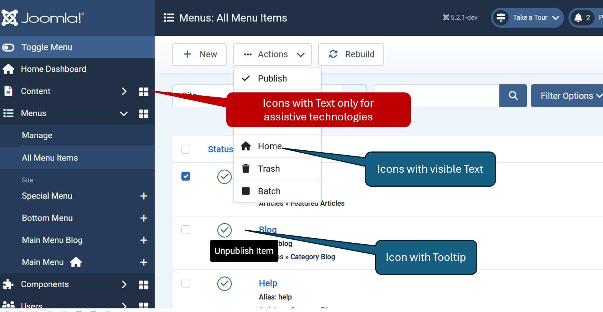

Standard Joomla! Icons 
=====

## Overview
Joomla uses the free [FontAwesome](https://fontawesome.com/search) icons and
implements the Icomoon icon subset through them.

The FontAwesome icons are implemented as [CSS pseudo-elements](https://docs.fontawesome.com/web/add-icons/pseudo-elements). 
This leads to three sub sets 
1) FontAwesome standard icons
2) FontAwesome brand icons
3) 'icon-' / subset to be compatible with J!3x and following versions

The source list of available icons can be found in joomla file `media/templates/administrator/atum/css/vendor/fontawesome-free.css`. For a visible representation of all icons with additional information see our [guide.joomla.org](https://guide.joomla.org/user-manual/templates/standard-icons)

### J!7
While in J!4-J!6 the FontAwesome icons provides most of the icons in the future J!7 will provide a more independent approach 
where `ìcon-...` defined ones will be used and hide the implementation with Font awesome or other font icon creators which will be exchangeable.

Joomla implemented the free standard icons, brand icons and supports a subset "icon-..." to be compatible with J!3x and following versions.

### class aria-hidden="true"

This class should be used when the icon is decorative next to visible text or inside a button with text. Hiding them means users of assistive tech hear only the meaningful content.
Leave the class out when the icon is meaningful on its own. A warning, success or error symbol that conveys status, with no text beside it. Better give it a text.

## Fontawesome icons
Fontawesome icons can be used for HTML in following forms:

```html
<span class="fa fa-!name! "></span>
<span style="font-size: 2rem;" class="fa fa-!name!"></span>
<i style="font-size: 2rem;" class="fa fa-!name!"></i>
```

The actual icon name fa-!name! class is accompanied by a prefix class like "fa ...". More below or see [FontAwesome 'classic' styles](https://docs.fontawesome.com/web/dig-deeper/styles)  

Add attribute ```aria-hidden="true"``` for hiding the icon from screen readers and improves accessibility. Use attribute ```style="font-size: 2rem;"``` or ```style="font-size: 48px;"``` for the size of the icon font.

### Standard icons

The Prefix part is ```fa``` which is short for ```fas``` which is short for ```fa-solid``` which can be used instead.

The icon name part begins with ```fa-``` and the name. Example: 
```php
<span class="fa fa-envelope"></span>
<span class="fa-solid fa-save" aria-hidden="true"></span> <?php echo Text::_('JSAVE') ?> 
```

### Brand icons

The prefix part is ```fab``` which is short for ```fa-brands``` which can be used instead

Example: 
```php
<span class="fab fa-joomla"></span>
<span class="fa-brands fa-facebook" aria-hidden="true"></span> <?php echo 'Facebook' ?> 
```

## Icomoon replacement form / 'icon' parameter in code function calls

For this set of icons, icon names from J3! (icomoon) were replaced (partly) by fontawesome icons. The icon itself is one of the fontawesome icons but the name may differ. Also, this is a smaller subset with fewer icons. It is kept for compatibility with J!3 icomoon replacements. In joomla code there are functions which accept the icon name as parameter.

### Direct HTML use

The class gets prefix "icon-" (e.g., "icon-calendar", "icon-file", etc.)

Form: ```<span class="icon-name"></span>```. The "name" part has to be replaced by the icon name. 
Add attribute aria-hidden="true" for hiding the icon from screen readers and improves accessibility. 

Example: 
```html
<span class="icon-joomla" style="font-size: 48px;" ></span>
<span class="icon-joomla" aria-hidden="true" style="font-size: 48px;" ></span>
```

### Parameter in J! functions

For example in HtmlView.php of a component the ToolBarHelper:: functions accept an icon name from this icon set.

Example: 
```html
ToolBarHelper::title(Text::_('COM_EXAMPLE_TITLE'), 'envelope');
```

:::tip
Instead of using an 'icon' name of the icon class (see above) a fontawesome icon may be used instead in following form. It is helpful when the required symbol is not available — or looks better.
```html
ToolBarHelper::title(Text::_('COM_EXAMPLE_TITLE'), 'none fa fa-camera-retro');
```
With 'none' given internally an 'icon-none' will be written into the HTML class and 'fa fa-camera-retro' will follow. 
Attention: This could affect subsequent button icons whose CSS formatting is then redefined.
:::

## Why \<span> should be used instead of often used \<i> to render an icon in HTML

For all icon definitions (using the `class="fa fa-!name!"` or `class="icon-name"` style), either a `<span>` or an `<i>` HTML element can be used. Both options are accepted by all browsers.

**\<i>** carries semantic meaning: It marks text in an alternate voice or mood, such as idiomatic phrases or technical terms.   
**\<span>** is a generic inline container that carries no specific semantic meaning.

The **\<i>** element for icons is recommended by icon libraries (such as Font Awesome) and Bootstrap 5. However,
there is ongoing discussion and controversy on the web regarding the use of the shorter **\<i>** element.

While both work technically and are widely supported, using a **\<span>** is the more standards-compliant, semantic, and future-proof choice.


## Icons and accessibility

Support accessibility depending on the situation. Imagine the user is blind or sees symbols only in a blur. Yet, they still want to know what it is about.

We have two situations:
1) The icon stands alone without further text
2) The icon has explanatory text beside it

Blind or visually impaired persons must get the whole information, every icon needs a textual representation. This can be a plain text, a title, a tooltip or also a text which is hidden from sighted users.

For example, if there is an icon-envelope, followed by the text "email me" then you can hide the icon with aria-hidden="true", and then the screen reader just reads the text - this is good practice. 

It there is only an icon-envelope but no text - then a blind user sees nothing and the screen reader probably reads nothing.

Then you must add an alt text to the icon like alt="contact me by e-mail"
or aria-hidden = "true" to the icon and add an invisible text "contact me by e-mail". 
You add invisible text by adding the "visually-hidden" attribute to an HTML element displaying text. This attribute means that the text can be read by screen readers, but will not be displayed on the web page. 

### Handling isolated symbols without further text

In this case you should support invisible text for screen readers.    
The first one is used in Joomla together with bootstrap.

```php
<span class="fa fa-envelope" aria-hidden="true" ></span>
    <span class="visually-hidden"><?php echo Text::_('CONTACT_ME_PER_EMAIL') ?></span> 
<span class="fa fa-envelope" aria-hidden="true"></span>
    <span class="sr-only"><?php echo Text::_('CONTACT_ME_PER_EMAIL') ?></span>
<span class="fa fa-envelope" aria-label="<?php echo Text::_('CONTACT_ME_PER_EMAIL') ?>"></span>
<span class="fa fa-envelope" alt="<?php echo Text::_('CONTACT_ME_PER_EMAIL') ?>"></span> 
```

### Handling icons with associated text

If there is the icon-envelope, followed by the text "email me" then you can hide the icon with aria-hidden="true", and then the screen reader just reads the text - good.

```php
<span class="fa fa-envelope" aria-hidden="true"></span><span><?php echo Text::_('CONTACT_ME_PER_EMAIL') ?></span> 
```

### Using 'alt-text' versus 'invisible text' 

There are different opinions about which is better - alt text or invisible text. Both variants are a11y compliant.  
In **Joomla CMS** we use the variant with **invisible** text.

### **Real Joomla! examples**



**Icon with text only**
```php
<span class="menu-dashboard">
    <a href="/Joomla5x/administrator/index.php?option=com_cpanel&amp;view=cpanel&amp;dashboard=components" title="Components Dashboard">
        <span>
            
        </span>
        <span class="visually-hidden">Components Dashboard</span>
        </a>
    </span>
```
Attention: The use of the title attribute in the link above will create a tooltip 

**Icon with visible text**

```php
<joomla-toolbar-button id="status-group-children-default" task="items.setDefault" list-selection="">
    <button class="button-default  dropdown-item" type="button">
        <span class="icon-default" aria-hidden="true"></span>
    Home
    </button>
</joomla-toolbar-button>
```

**Icon with tooltip**
```php
<td class="text-center">
    <a href="#" class="js-grid-item-action tbody-icon active" data-item-id="cb1" data-item-task="items.unpublish" data-item-form-id="" aria-describedby="cbunpublish1-desc">
        <span class="icon-publish" aria-hidden="true"></span>
    </a>
    <div role="tooltip" id="cbunpublish1-desc">Unpublish Item</div>                                                                    
</td>
```

## Using other icon sets

In case you want to display other icons not included in the Joomla pack, you have several options, one of which is to use additional FontAwesome icons.
This can be achieved in different ways depending on your needs:
1. Using FontAwesome Kit - this is the easiest approach, but you should have an account on their site.
2. Using self-hosted webfonts and additional CSS files from FontAwesome.
3. Using self-hosted SVG and JS files - for a few icons, this way you will have some speed optimization.
